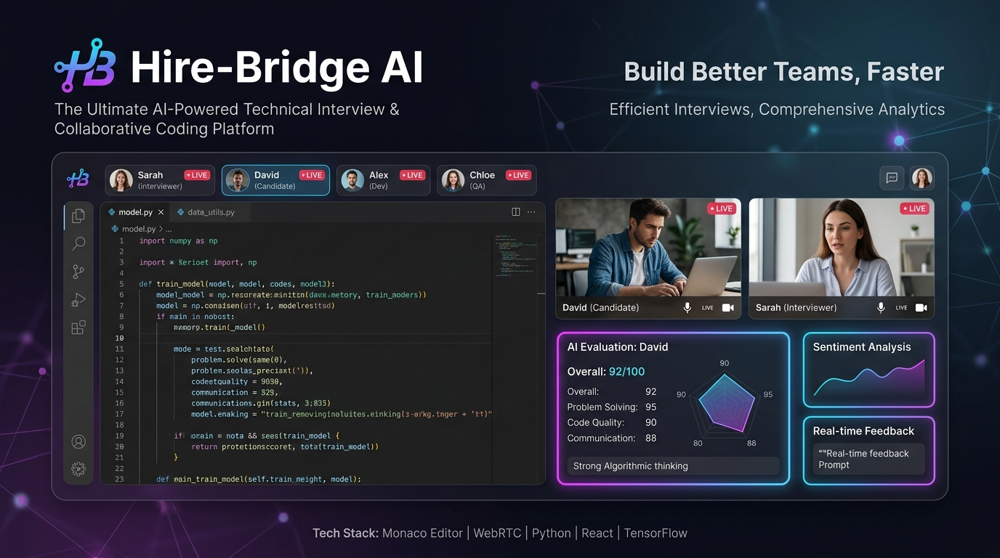
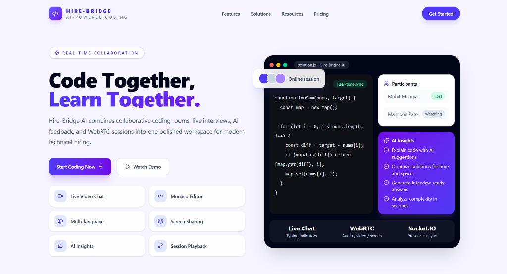
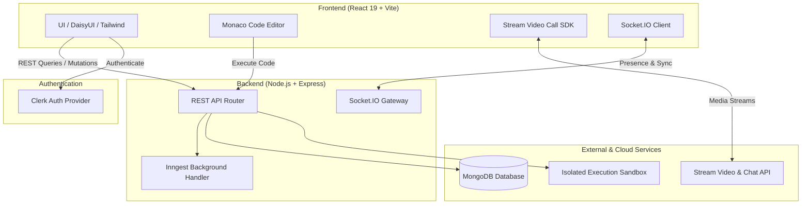

<div align="center">

  

  <br />
  <br />

  # 🚀 Hire-Bridge AI
  ### The Ultimate AI-Powered Technical Interview & Collaborative Coding Platform

  <p align="center">
    <b>Empowering engineering teams and candidates with real-time collaborative coding, low-latency WebRTC video interviews, and instant AI-driven code evaluation.</b>
  </p>

  <p align="center">
    <a href="#-key-features">Features</a> •
    <a href="#-tech-stack">Tech Stack</a> •
    <a href="#-architecture">Architecture</a> •
    <a href="#-getting-started">Getting Started</a> •
    <a href="#-environment-variables">Environment Setup</a> •
    <a href="#-contributing">Contributing</a>
  </p>

  <p align="center">
    
    
    
    
    
    
    
    
    
    
  </p>

</div>

---

## 📸 Application Preview

<div align="center">
  
  <p><i>Live collaborative coding room with Monaco Editor, WebRTC video calling, participant presence, and AI insights.</i></p>
</div>

---

## ✨ Overview

**Hire-Bridge AI** is an all-in-one technical hiring and peer programming workspace designed for high-performance engineering interviews. It eliminates friction by unifying video calling, code editing, isolated sandbox execution, and AI insights into a single responsive web interface.

Whether you are conducting a technical interview or practicing Data Structures & Algorithms solo, Hire-Bridge provides an intuitive, distraction-free environment.

---

## ⚡ Key Features

| Feature | Description |
| :--- | :--- |
| 🧑‍💻 **Monaco Code Editor** | Full VS Code editing experience with syntax highlighting, autocomplete, bracket matching, and multi-language support (JavaScript, Python, Java). |
| 🎥 **1-on-1 WebRTC Video Rooms** | High-definition, low-latency audio/video powered by Stream Video SDK with microphone toggles, camera feeds, and screen sharing. |
| 🤖 **AI-Driven Code Insights** | Instant algorithmic complexity analysis ($O(n)$ time/space), optimization suggestions, and interview-ready feedback. |
| 🔒 **Room Locking & Candidate Security** | Automated room locking limiting active sessions to 2 participants (interviewer & candidate), verified via Clerk Authentication. |
| 💬 **Real-Time Chat & Collaboration** | Live chat messaging, presence indicators, real-time typing notifications, and cursor sync with Socket.IO. |
| 🎯 **Automated Test Case Runner** | Executes code in an isolated environment against custom test cases with instant pass/fail metrics and celebratory confetti animations. |
| 🧩 **Solo Practice Arena** | Curated catalog of coding challenges for candidates to practice algorithms independently before live interviews. |
| 🧠 **Background Workflows** | Reliable background jobs and asynchronous workflows orchestrating event-driven tasks powered by Inngest. |

---

## 🛠️ Tech Stack

### Frontend
- **Framework**: [React 19](https://react.dev/) + [Vite](https://vitejs.dev/)
- **Styling**: [Tailwind CSS v4](https://tailwindcss.com/) + [DaisyUI](https://daisyui.com/)
- **Code Editor**: [@monaco-editor/react](https://github.com/suren-atoyan/monaco-react)
- **Video & Chat**: [@stream-io/video-react-sdk](https://getstream.io/video/) & [stream-chat-react](https://getstream.io/chat/)
- **State & Data Fetching**: [@tanstack/react-query](https://tanstack.com/query) & [Axios](https://axios-http.com/)
- **Authentication**: [@clerk/clerk-react](https://clerk.com/)
- **Icons & Effects**: [Lucide React](https://lucide.dev/), `canvas-confetti`, `react-hot-toast`

### Backend
- **Runtime**: [Node.js](https://nodejs.org/) & [Express 5](https://expressjs.com/)
- **Database**: [MongoDB](https://www.mongodb.com/) via [Mongoose](https://mongoosejs.com/)
- **Real-Time Communication**: [Socket.IO](https://socket.io/)
- **Video & Stream Services**: [@stream-io/node-sdk](https://getstream.io/)
- **Auth Middleware**: [@clerk/express](https://clerk.com/)
- **Background Jobs**: [Inngest SDK](https://www.inngest.com/)
- **Document Processing**: `pdf-parse`, `mammoth`, `multer`

---

## 🏗️ System Architecture



---

## 📂 Project Structure

```text
Hire-Bridge-1/
├── assets/                  # Badges, banners, and screenshots for documentation
│   ├── banner.jpg           # High-resolution README header banner
│   └── app-screenshot.png   # Application interface preview
├── backend/                 # Node.js Express backend
│   ├── src/
│   │   ├── controllers/     # Route handlers & business logic
│   │   ├── models/          # Mongoose database schemas
│   │   ├── routes/          # Express API route endpoints
│   │   ├── inngest/         # Inngest asynchronous job functions
│   │   └── server.js        # Main server entry & Socket.IO initialization
│   └── package.json
├── frontend/                # Vite + React frontend application
│   ├── public/              # Static assets & icons
│   ├── src/
│   │   ├── components/      # Reusable UI components & layouts
│   │   ├── pages/           # Application views (Home, Interview, Practice, Dashboard)
│   │   ├── hooks/           # Custom React hooks & queries
│   │   └── App.jsx          # Route configuration & providers
│   └── package.json
└── README.md
```

---

## ⚙️ Environment Variables

### 1. Backend (`backend/.env`)

```env
PORT=3000
NODE_ENV=development

# MongoDB Connection
DB_URL=mongodb+srv://<username>:<password>@cluster.mongodb.net/hirebridge?retryWrites=true&w=majority

# Inngest Keys
INNGEST_EVENT_KEY=your_inngest_event_key
INNGEST_SIGNING_KEY=your_inngest_signing_key

# Stream Video & Chat API Keys
STREAM_API_KEY=your_stream_api_key
STREAM_API_SECRET=your_stream_api_secret

# Clerk Authentication
CLERK_PUBLISHABLE_KEY=your_clerk_publishable_key
CLERK_SECRET_KEY=your_clerk_secret_key

# Client Application URL
CLIENT_URL=http://localhost:5173
```

### 2. Frontend (`frontend/.env`)

```env
# Clerk Authentication
VITE_CLERK_PUBLISHABLE_KEY=your_clerk_publishable_key

# Backend API Endpoint
VITE_API_URL=http://localhost:3000/api

# Stream Video API Key
VITE_STREAM_API_KEY=your_stream_api_key
```

---

## 🚀 Getting Started

### Prerequisites

Ensure you have the following installed:
- [Node.js](https://nodejs.org/) (v18.0.0 or higher)
- [npm](https://www.npmjs.com/) or [yarn](https://yarnpkg.com/)
- [MongoDB](https://www.mongodb.com/) (Local instance or MongoDB Atlas cluster)
- Free accounts for [Clerk](https://clerk.com/) and [Stream](https://getstream.io/)

### Installation & Local Setup

1. **Clone the repository:**
   ```bash
   git clone https://github.com/immansoon001/Hire-Bridge-1.git
   cd Hire-Bridge-1
   ```

2. **Configure Environment Variables:**
   - Copy the `.env` examples above into `backend/.env` and `frontend/.env`.

3. **Install Dependencies & Start Backend:**
   ```bash
   cd backend
   npm install
   npm run dev
   ```
   *The backend will boot up at `http://localhost:3000`.*

4. **Install Dependencies & Start Frontend:**
   ```bash
   cd ../frontend
   npm install
   npm run dev
   ```
   *The client app will launch at `http://localhost:5173`.*

---

## 🤝 Contributing

Contributions, issues, and feature requests are welcome!

1. Fork the Project
2. Create your Feature Branch (`git checkout -b feature/AmazingFeature`)
3. Commit your Changes (`git commit -m 'feat: Add AmazingFeature'`)
4. Push to the Branch (`git push origin feature/AmazingFeature`)
5. Open a Pull Request

---

## 📄 License

Distributed under the **MIT License**. See `LICENSE` for more information.

---

<div align="center">
  <sub>Built with ❤️ by <a href="https://github.com/immansoon001">immansoon001</a> and contributors</sub>
</div>
